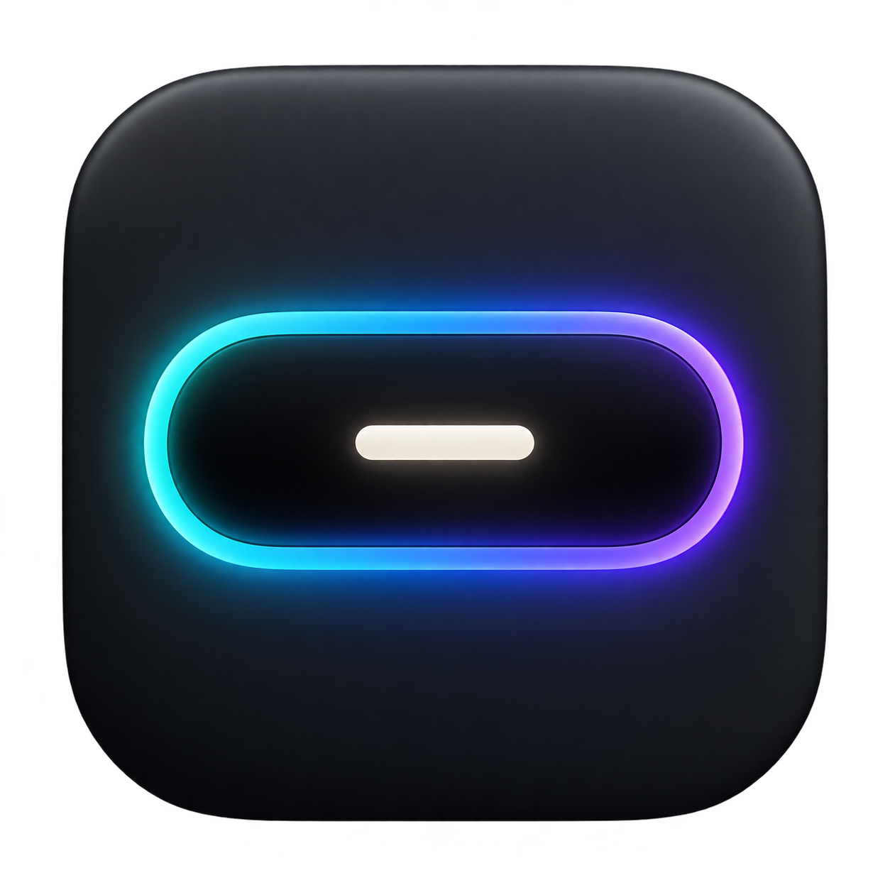
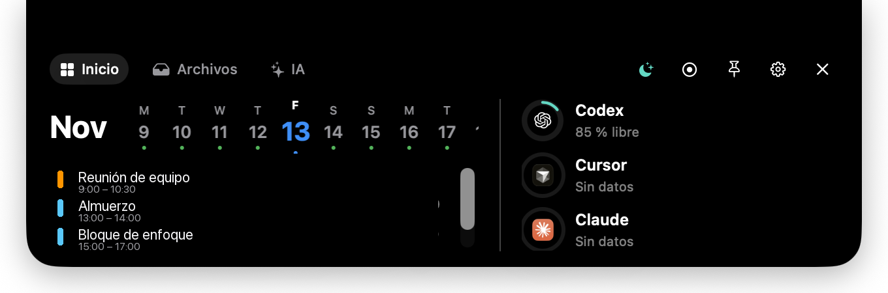
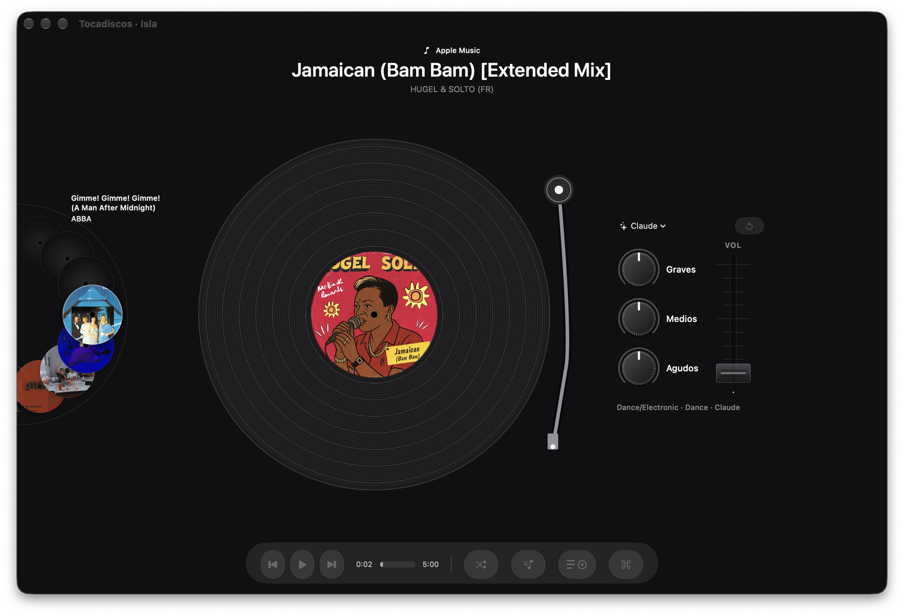
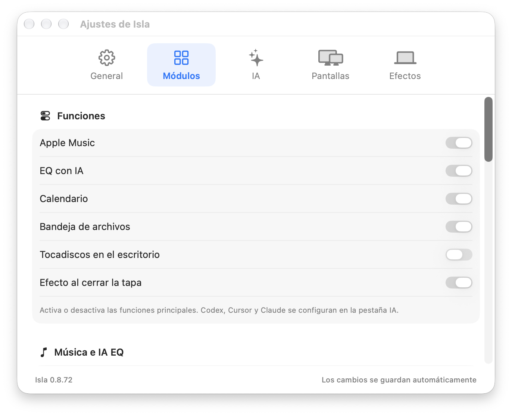
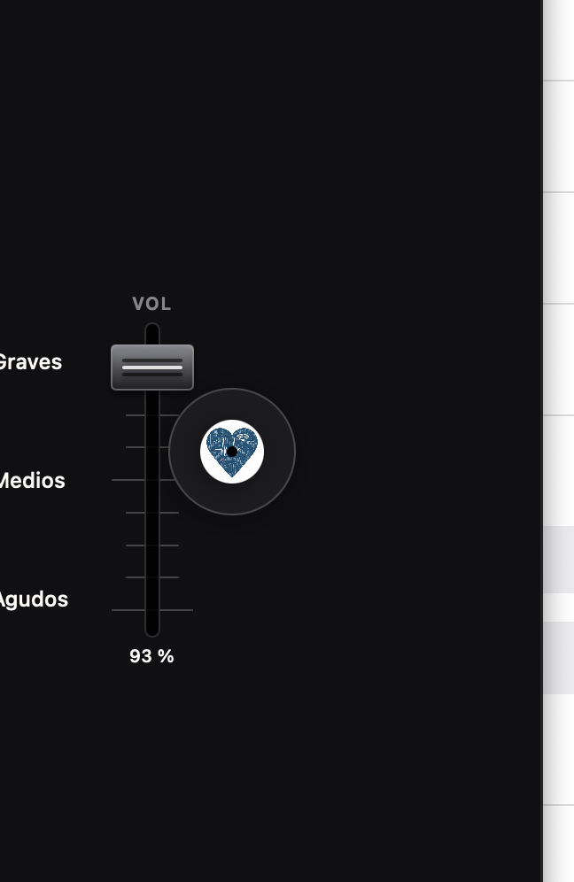
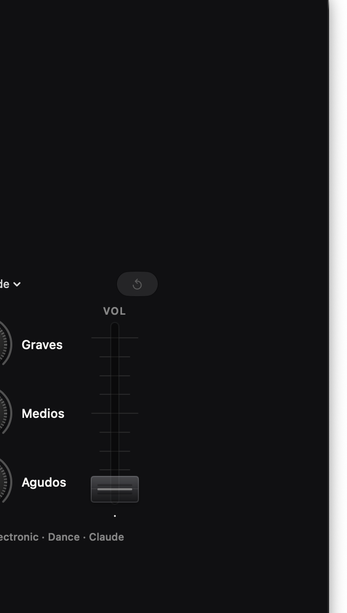

# Isla

Isla convierte el notch del Mac en un espacio compacto para música, calendario, actividad de IA y archivos. Está hecha con SwiftUI y AppKit para macOS.

**[Descargar Isla.zip](https://github.com/joanferreres/Isla/releases/latest/download/Isla.zip)** · **[Instalación](docs/INSTALACION.md)** · **[Solución de problemas](docs/PROBLEMAS.md)** · **[Compilar](docs/COMPILAR.md)**

## Vista rápida

## Funciones

### Isla dinámica

- Se abre al hacer clic dentro del notch (no al pasar el puntero).
- Carátula y controles cuando Apple Music o Spotify están sonando.
- Reparte el espacio entre música, calendario y actividad de IA.
- Se puede fijar abierta y mostrar en una o todas las pantallas.

### Apple Music, Spotify y tocadiscos

- Fuente automática o selección manual de Apple Music / Spotify.
- Carátula, título, artista, progreso, búsqueda de posición, volumen, aleatorio y controles de reproducción en ambas apps.
- Tocadiscos a ventana completa: vinilo animado, brazo, ondas y ambientes <kbd>⌘0</kbd>–<kbd>⌘9</kbd>.
- **Selector de discos** en el borde izquierdo: gira con el trackpad, abanico al pasar el cursor, clic en un disco para cargarlo.
- Mesa DJ: volumen, Graves / Medios / Agudos, presets de fábrica de Música.
- Estilo **Claude**: auto-EQ según el tipo de música (Claude o ChatGPT).
- Widget nativo y tocadiscos compacto en el escritorio para ambas fuentes.
- Apple Music añade EQ, playlists y selector de discos; Spotify no expone esas tres funciones a otras apps de macOS.

### EQ con IA y toggles de funciones

- En **Ajustes → Módulos → Funciones**: música con fuente automática / Apple Music / Spotify, **EQ con IA**, Calendario, bandeja de archivos, tocadiscos en el escritorio y efecto de tapa.
- En el tocadiscos, el menú de estilo incluye **Claude** (respeta el interruptor de EQ con IA).
- El EQ con IA detecta la salida (AirPods, auriculares o altavoces del Mac) y adapta la curva al cambiar de dispositivo.
- API keys de **Claude** y **ChatGPT** en el llavero (orden: key Claude → key ChatGPT; también `ANTHROPIC_API_KEY` / `OPENAI_API_KEY`). El EQ no usa la sesión OAuth de Claude Code.

### Calendario, IA, archivos y tapa

- Calendario del día, recordatorio previo al próximo evento.
- Límites de Codex, Cursor y Claude en Inicio. Una cuenta conectada se mantiene visible; si la consulta falla muestra el último dato en gris.
- Bandeja de archivos y AirDrop desde el notch.
- Efecto opcional al cerrar la tapa (MacBook con sensor).

## Requisitos

- Mac Apple Silicon (M1 o posterior). El binario actual es `arm64`.
- macOS 15 o posterior.
- Firma personal local (**no** notarizada por Apple). Ver [instalación](docs/INSTALACION.md#primer-aviso-de-macos).

## Permisos de macOS (necesarios para que todo funcione)

Concede solo lo que uses. Ruta base: **Ajustes del Sistema → Privacidad y seguridad**.

| Permiso | Dónde activarlo | Para qué |
| --- | --- | --- |
| **Automatización → Music / Spotify** | Privacidad y seguridad → Automatización → Isla → **Music** o **Spotify** | Leer la canción y controlar reproducción, posición, volumen y aleatorio. Apple Music añade playlists y EQ. |
| **Accesibilidad** | Privacidad y seguridad → Accesibilidad → activa **Isla** | Mandos Graves/Medios/Agudos, cambio de presets en la ventana EQ de Música, y añadir canciones del catálogo a playlists. |
| **Calendarios** | Privacidad y seguridad → Calendarios | Eventos del día y recordatorio previo. Isla solo lee. |
| **Grabación de pantalla** | Privacidad y seguridad → Grabación de pantalla y de sistema | Solo el efecto visual al cerrar la tapa. No guarda vídeo. |
| **Llavero** | Diálogo de macOS al conectar Claude/Cursor o al guardar API keys | Leer (solo para mostrar límites de uso) la sesión de Claude Desktop («Claude Safe Storage»), el OAuth de Claude Code o Cursor Safe Storage; guardar keys de Claude y ChatGPT para el EQ con IA. |
| **Archivos / capturas** (opcional) | Al activar capturas en Ajustes | Guardar en `Escritorio/capturas` y copiar al portapapeles. |

Isla **no** usa el micrófono. El Bluetooth solo lee el porcentaje de batería si el altavoz lo publica; no hay un interruptor aparte en Privacidad.

## Primeros pasos (setup inicial)

Tarda unos 5 minutos. Haz los pasos 1–3 y deja el resto para cuando quieras cada función.

### 1. Instalar

1. Descarga **Isla.zip** de la [última release](https://github.com/joanferreres/Isla/releases/latest) (no «Source code»).
2. Descomprime y arrastra **Isla.app** a la carpeta **Aplicaciones**.
3. Ábrela **desde Aplicaciones**. Isla no tiene ventana: vive en el **notch** y en un icono de la **barra de menús**.

### 2. Saltar el aviso de macOS (solo la primera vez)

Isla no está notarizada por Apple, así que macOS puede bloquearla al abrirla:

1. Intenta abrirla una vez y cierra el aviso.
2. Ve a **Ajustes del Sistema → Privacidad y seguridad**, baja hasta **Seguridad** y pulsa **Abrir igualmente** junto a Isla.

Más detalle en [docs/INSTALACION.md](docs/INSTALACION.md#primer-aviso-de-macos).

### 3. Abrir la isla y activar módulos

- **Haz clic dentro del notch** para abrirla (pasar el puntero no la abre). El menú de la barra o la rueda ⚙︎ llevan a **Ajustes**.
- En **Ajustes → Módulos** activa solo lo que vayas a usar: Música, Calendario, bandeja de archivos, EQ con IA…

### 4. Conectar cada función (opcional, en este orden)

| Quiero… | Qué hacer |
| --- | --- |
| **Música** | Ajustes → Módulos → Música: elige Automática, Apple Music o Spotify y reproduce una canción. Acepta el aviso de **Automatización** (o actívalo en Privacidad y seguridad → Automatización → Isla → Music/Spotify). |
| **EQ / tocadiscos** | Abre el tocadiscos y gira un mando. Si macOS pide **Accesibilidad**, actívala para Isla y vuelve a girarlo. |
| **Calendario** | Activa Calendario y concede el permiso de **Calendarios**. Isla solo lee. |
| **Consumo de IA (Codex, Cursor, Claude)** | Ver la sección siguiente. |
| **EQ con IA** | Pega una API key de Claude (`sk-ant-…`) o de ChatGPT en Ajustes → Música, o define `ANTHROPIC_API_KEY` / `OPENAI_API_KEY` en tu shell. No sirve la sesión de un plan de Claude. |
| **Archivos / AirDrop** | Arrastra archivos desde Finder al notch. No requiere permisos. |
| **Efecto de tapa** | Actívalo y concede **Grabación de pantalla** (solo para el efecto; no guarda vídeo). |

### 5. Conectar el consumo de IA (Codex, Cursor, Claude)

Isla muestra el uso de tus límites y avisa cuando una tarea de IA termina. **No pide contraseñas ni API keys**: reutiliza la sesión de las apps que ya tienes abiertas con tu cuenta.

1. Inicia sesión en la app correspondiente (**Cursor**, **Claude** de escritorio, o `claude auth login` en Claude Code) y úsala al menos una vez.
2. En Isla: **Ajustes → IA**, activa **Conectar Cursor** / **Conectar Claude** y pulsa **Actualizar** (para Claude, «Permitir acceso a Claude»).
3. macOS pedirá acceso al **llavero** («Cursor Safe Storage», «Claude Safe Storage» o «Claude Code-credentials»). Pulsa **Permitir** (o **Permitir siempre** para que no vuelva a preguntar).
4. Activa **Mostrar … en Inicio** para verlo en el notch.

Una cuenta conectada se queda en el notch aunque falle la consulta: muestra «Sin datos» o el último valor en gris («antiguo») y el motivo en Ajustes → IA. Si el dato aparece antiguo, abre la app de la cuenta (Cursor / Claude) para renovar su sesión y pulsa **Actualizar**. Si Claude sigue fallando, ejecuta `claude auth login`. Más ayuda en [Solución de problemas](docs/PROBLEMAS.md).

## Actualizaciones

Isla consulta releases públicas de GitHub (como máximo una vez por semana). También: **Buscar actualizaciones…** en el menú o en **Ajustes → General**.

Sustitución manual: sal de Isla → descarga el ZIP → reemplaza la app en Aplicaciones → vuelve a abrir.

## Versión actual

**Isla 0.8.82**.

Artefactos de release esperados: `Isla.zip` + `SHA256SUMS.txt`. Firma: identidad personal `Isla Personal Code Signing` (Team ID vacío; **sin notarización**). Gatekeeper puede pedir «Abrir igualmente».

## Desarrollo

Consulta [COMPILAR.md](docs/COMPILAR.md) para pruebas, empaquetado y publicación. Licencias de terceros: [THIRD-PARTY-NOTICES.md](THIRD-PARTY-NOTICES.md).

Isla es un proyecto independiente de Apple, OpenAI, Anthropic, Cursor y los servicios mencionados.
