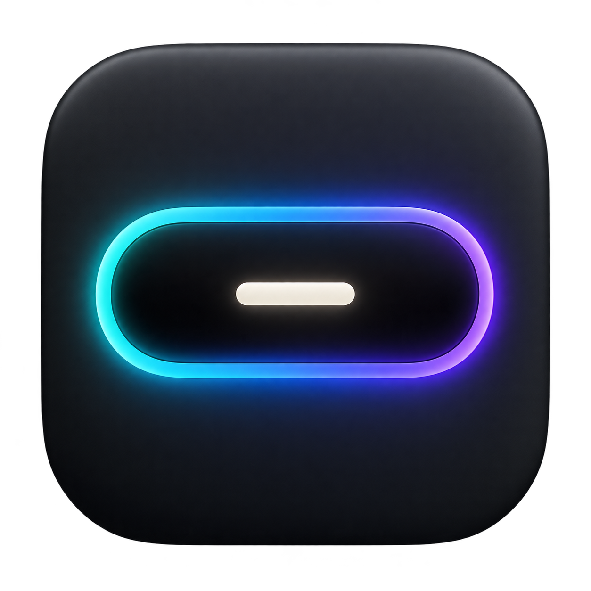
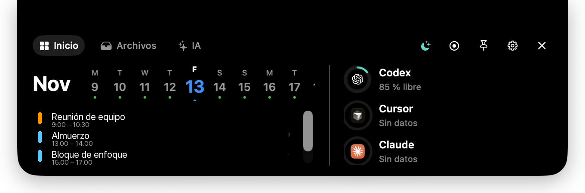
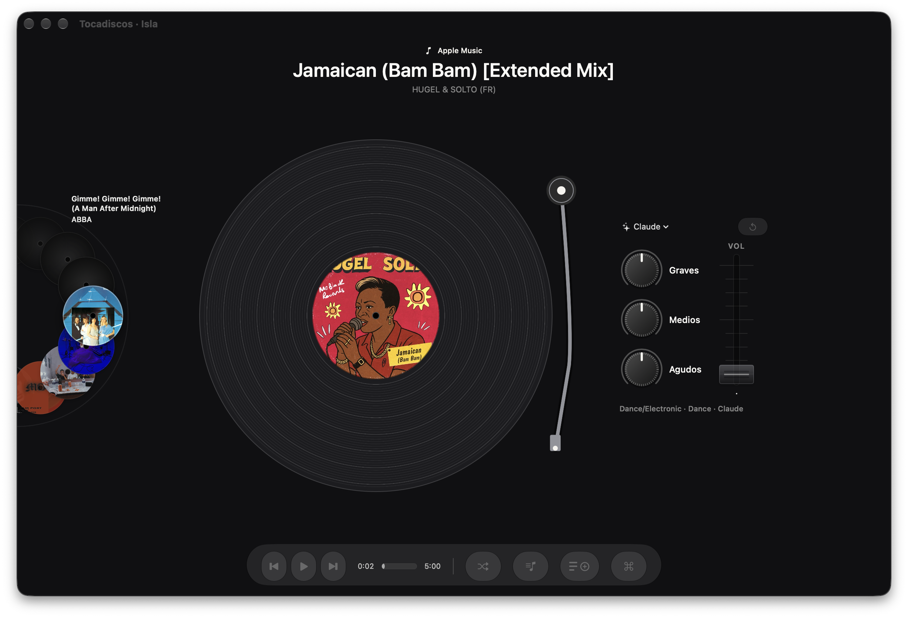
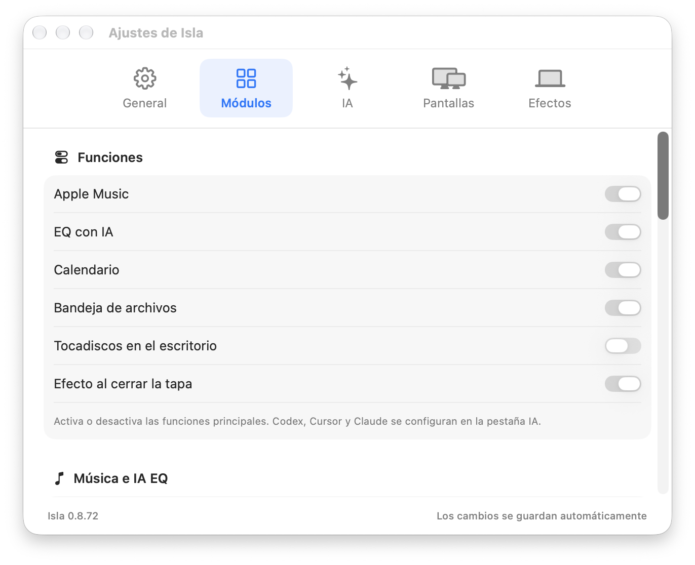
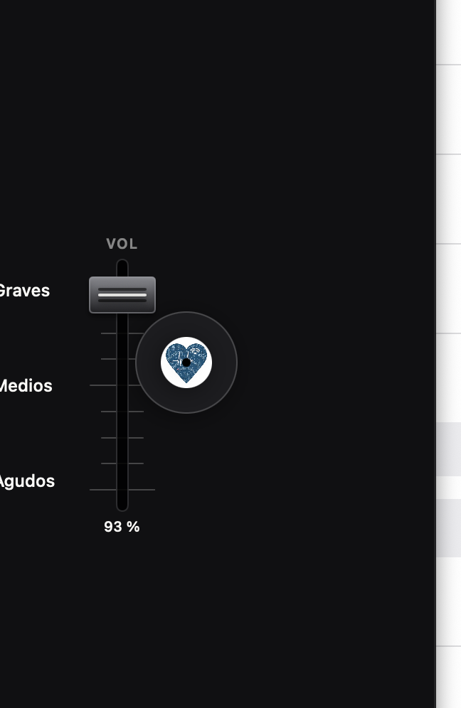
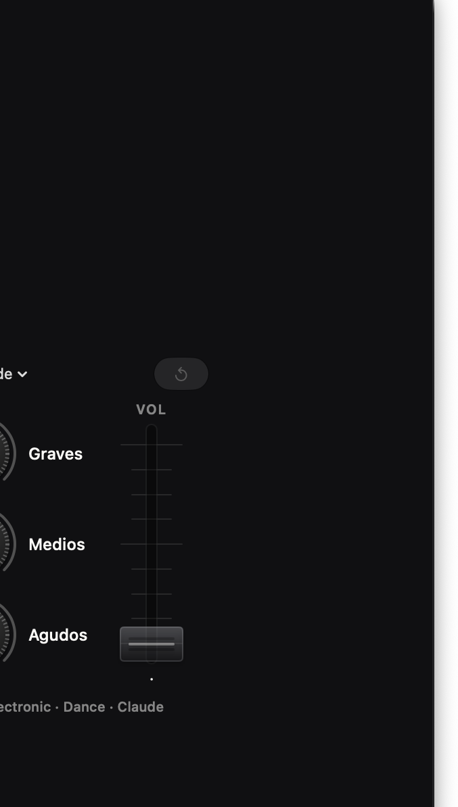

# Isla

Isla convierte el notch del Mac en un espacio compacto para música, calendario, actividad de IA y archivos. Está hecha con SwiftUI y AppKit para macOS.

**[Descargar Isla.zip](https://github.com/joanferreres/Isla/releases/latest/download/Isla.zip)** · **[Instalación](docs/INSTALACION.md)** · **[Solución de problemas](docs/PROBLEMAS.md)** · **[Compilar](docs/COMPILAR.md)**

## Vista rápida

## Funciones

### Isla dinámica

- Se abre al hacer clic dentro del notch (no al pasar el puntero).
- Carátula y controles cuando Apple Music está sonando.
- Reparte el espacio entre música, calendario y actividad de IA.
- Se puede fijar abierta y mostrar en una o todas las pantallas.

### Apple Music y tocadiscos

- Carátula, título, artista y controles de reproducción.
- Tocadiscos a ventana completa: vinilo animado, brazo, ondas y ambientes <kbd>⌘0</kbd>–<kbd>⌘9</kbd>.
- **Selector de discos** en el borde izquierdo: gira con el trackpad, abanico al pasar el cursor, clic en un disco para cargarlo.
- Mesa DJ: volumen, Graves / Medios / Agudos, presets de fábrica de Música.
- Estilo **Claude**: auto-EQ según el tipo de música (Claude o ChatGPT).
- Playlist, aleatorio, widget nativo y tocadiscos compacto en el escritorio.

### EQ con IA y toggles de funciones

- En **Ajustes → Módulos → Funciones**: interruptores para Apple Music, **EQ con IA**, Calendario, bandeja de archivos, tocadiscos en el escritorio y efecto de tapa.
- En el tocadiscos, el menú de estilo incluye **Claude** (respeta el interruptor de EQ con IA).
- El EQ con IA detecta la salida (AirPods, auriculares o altavoces del Mac) y adapta la curva al cambiar de dispositivo.
- API keys de **Claude** y **ChatGPT** en el llavero (orden: OAuth Claude Code → key Claude → key ChatGPT, o `ANTHROPIC_API_KEY` / `OPENAI_API_KEY`).

### Calendario, IA, archivos y tapa

- Calendario del día, recordatorio previo al próximo evento.
- Límites de Codex, Cursor y Claude en Inicio (solo si la consulta funciona; si no, se ocultan hasta Ajustes → IA).
- Bandeja de archivos y AirDrop desde el notch.
- Efecto opcional al cerrar la tapa (MacBook con sensor).

## Requisitos

- Mac Apple Silicon (M1 o posterior). El binario actual es `arm64`.
- macOS 15 o posterior.
- Firma personal local (**no** notarizada por Apple). Ver [instalación](docs/INSTALACION.md#primer-aviso-de-macos).

## Permisos de macOS (necesarios para que todo funcione)

Concede solo lo que uses. Ruta base: **Ajustes del Sistema → Privacidad y seguridad**.

| Permiso | Dónde activarlo | Para qué |
| --- | --- | --- |
| **Automatización → Music** | Privacidad y seguridad → Automatización → Isla → **Music** | Carátula, controles, playlists, volumen y presets del EQ vía AppleScript. Sin esto, Música no responde. |
| **Accesibilidad** | Privacidad y seguridad → Accesibilidad → activa **Isla** | Mandos Graves/Medios/Agudos, cambio de presets en la ventana EQ de Música, y añadir canciones del catálogo a playlists. |
| **Calendarios** | Privacidad y seguridad → Calendarios | Eventos del día y recordatorio previo. Isla solo lee. |
| **Grabación de pantalla** | Privacidad y seguridad → Grabación de pantalla y de sistema | Solo el efecto visual al cerrar la tapa. No guarda vídeo. |
| **Llavero** | Diálogo de macOS al conectar Claude/Cursor o al guardar API keys | Leer sesión de Claude Desktop («Claude Safe Storage») u OAuth de Claude Code / Cursor Safe Storage; guardar keys de Claude y ChatGPT para el EQ con IA. |
| **Archivos / capturas** (opcional) | Al activar capturas en Ajustes | Guardar en `Escritorio/capturas` y copiar al portapapeles. |

### Pasos claros (checklist)

1. Instala **Isla.app** en **Aplicaciones** y ábrela una vez. Si Gatekeeper avisa, usa **Abrir igualmente** ([detalle](docs/INSTALACION.md#primer-aviso-de-macos)).
2. En Isla → **Ajustes → Módulos**, activa **Apple Music** y reproduce una canción en la app Música.
3. Si pide control de Música, acepta; si no, ve a **Automatización** y marca **Music** para Isla.
4. Abre el tocadiscos y gira un mando del EQ. Si macOS pide Accesibilidad, actívala y vuelve a intentarlo.
5. (Opcional) **EQ con IA**: activa el interruptor o elige estilo **Claude**. Pega keys en Ajustes → Música o usa `claude auth login` + permiso de llavero.
6. (Opcional) Calendario, efecto de tapa y capturas: actívalos y concede Calendarios / Grabación de pantalla cuando lo pidan.

Isla **no** usa el micrófono. El Bluetooth solo lee el porcentaje de batería si el altavoz lo publica; no hay un interruptor aparte en Privacidad.

## Instalación rápida

1. Descarga **Isla.zip** desde la [última release](https://github.com/joanferreres/Isla/releases/latest).
2. Descomprime y mueve **Isla.app** a **Aplicaciones**.
3. Ábrela y configura permisos con la tabla de arriba.
4. Guía completa: [docs/INSTALACION.md](docs/INSTALACION.md).

## Actualizaciones

Isla consulta releases públicas de GitHub (como máximo una vez por semana). También: **Buscar actualizaciones…** en el menú o en **Ajustes → General**.

Sustitución manual: sal de Isla → descarga el ZIP → reemplaza la app en Aplicaciones → vuelve a abrir.

## Versión actual

**Isla 0.8.76** (compilación 106).

Artefactos de release esperados: `Isla.zip` + `SHA256SUMS.txt`. Firma: identidad personal `Isla Personal Code Signing` (Team ID vacío; **sin notarización**). Gatekeeper puede pedir «Abrir igualmente».

## Desarrollo

Consulta [COMPILAR.md](docs/COMPILAR.md) para pruebas, empaquetado y publicación. Licencias de terceros: [THIRD-PARTY-NOTICES.md](THIRD-PARTY-NOTICES.md).

Isla es un proyecto independiente de Apple, OpenAI, Anthropic, Cursor y los servicios mencionados.
