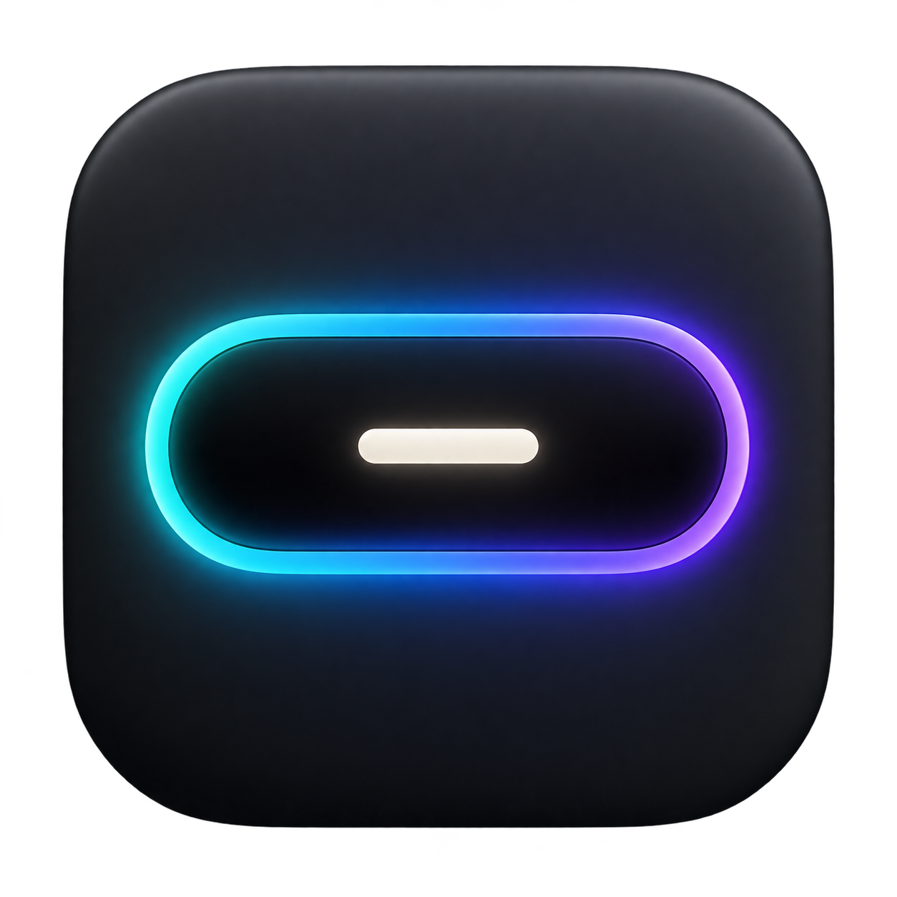

# Isla

Una isla dinámica para el notch del Mac, hecha con SwiftUI y AppKit. Proyecto personal y experimental, inspirado en NotchNook y CodeNotch.

**[Descargar Isla.zip](https://github.com/joanferreres/Isla/releases/latest/download/Isla.zip)** · **[Manual de instalación](docs/INSTALACION.md)** · **[Solución de problemas](docs/PROBLEMAS.md)** · **[Compilar desde el código](docs/COMPILAR.md)**

## Requisitos

- Mac con Apple Silicon: M1, M2, M3, M4 o posterior. El ZIP actual no funciona en Intel.
- macOS 15 o posterior. Probada principalmente en un MacBook Pro M4 con macOS 27; no se ha validado cada versión o modelo.
- El efecto al cerrar la tapa requiere un MacBook con un sensor compatible. La isla puede colocarse también en monitores externos.

## Instalación rápida

1. Entra en **[Releases](https://github.com/joanferreres/Isla/releases)** y descarga el archivo **Isla.zip** de la versión más reciente. Los archivos automáticos «Source code» contienen el código, no la aplicación lista para abrir.
2. Descomprime el ZIP y arrastra **Isla.app** a **Aplicaciones**.
3. Intenta abrirla. Si macOS muestra un aviso de desarrollador no identificado, sigue el [manual](docs/INSTALACION.md).
4. Abre los ajustes de Isla y activa únicamente las conexiones que quieras usar.

No hace falta una suscripción de Apple Developer para compilarla o compartir esta copia. La aplicación tiene firma personal y **no está notarizada por Apple**: GitHub facilita la descarga, pero no evita los avisos de seguridad de macOS. Si recibes «This application can’t be opened», consulta [el diagnóstico](docs/PROBLEMAS.md); no está confirmado que el ZIP abra en todos los Macs compatibles.

Si el repositorio es privado, el propietario debe invitar a su amigo como colaborador y este debe iniciar sesión en GitHub para acceder a las descargas. También puede enviarle el ZIP directamente.

## Qué incluye

- Hover para resaltar la isla y clic para abrirla; menú secundario con ajustes, fijar y salir.
- Carátula y controles de Apple Music, y metadatos multimedia compatibles.
- Calendario, agenda y recordatorio del siguiente evento durante los diez minutos anteriores.
- Información de uso de Codex, Cursor y Claude cuando la integración y la sesión lo permiten. Los límites mostrados dependen de los datos que facilite cada servicio.
- Aviso al terminar tareas de Codex y tres modos: sonido y aviso visual, solo visual o sin avisos.
- Bandeja de archivos con miniaturas y opciones de compartir y AirDrop.
- Selección de pantallas y efecto opcional al mover la tapa.

## Primer uso y privacidad

Cada persona configura sus propias cuentas y permisos. El paquete no contiene calendarios, conversaciones, tokens de acceso ni claves privadas de firma del autor. Las conexiones de IA usan las sesiones locales del usuario y pueden consultar los servicios correspondientes. Calendario, Automatización de Music y Grabación de pantalla solo son necesarios para sus funciones respectivas. El efecto de tapa usa una captura durante el gesto; no guarda un vídeo.

## Estado del proyecto

Versión inicial publicada: **0.8.7**. Hay 111 pruebas automatizadas, pero estas no sustituyen la comprobación en otros Macs. Los clics dentro del notch físico requieren validación con entrada física en el equipo de destino. El mensaje de apertura recibido en el Mac de un amigo sigue pendiente de diagnóstico.

Las integraciones multimedia, el sensor de tapa y algunos datos de IA usan interfaces que pueden cambiar entre versiones. Las consultas de límites no representan una garantía de crédito disponible.

## Desarrollo y créditos

Consulta [cómo compilar, probar y preparar una versión](docs/COMPILAR.md). Las referencias, adaptaciones y licencias de terceros se conservan en [THIRD-PARTY-NOTICES.md](THIRD-PARTY-NOTICES.md) y [Vendor/MediaRemoteAdapter/LICENSE](Vendor/MediaRemoteAdapter/LICENSE). Isla es un proyecto independiente de las aplicaciones y proveedores mencionados.
